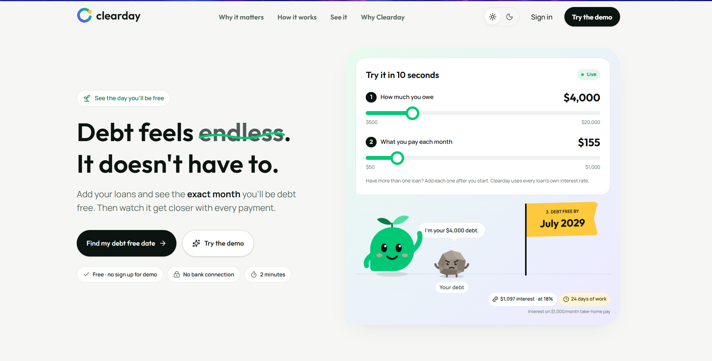
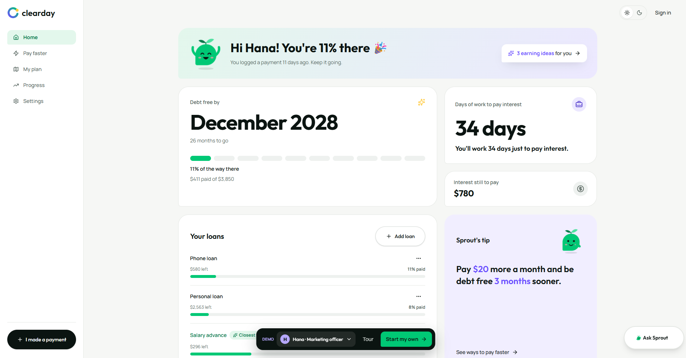
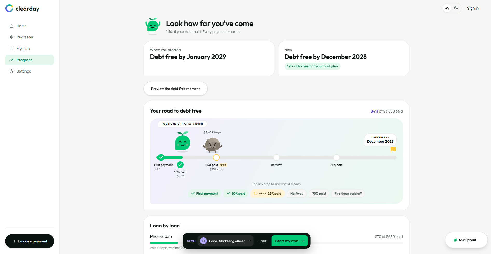

# Clearday 🌱

**See the exact month you'll be debt free.**

Clearday is a web app for young working people with a few small loans. You add your loans and it shows you the month you'll be debt free, how much of your time goes to interest and small ways to get there faster. Then you watch that date get closer with every payment.

I built it solo in 72 hours for **Lovable SheBuilds Season 04** (October 2026) in the Consumer Apps category.

**Live app:** https://myclearday.lovable.app
You can try the demo with no sign up.



## Why I built it

Most people with small loans pay something every month but have no idea when it will end, so the debt starts to feel endless. Clearday gives one clear answer first, the month you'll be free, and then makes the cost feel real by showing interest as days of work. "24 days of work" is much harder to ignore than "$1,097".

## Features

| Part | What it does |
| --- | --- |
| Landing calculator | Two sliders give a debt free month in about 10 seconds |
| Home | The debt free date, days of work going to interest and each loan's progress |
| Pay faster | Shows how a little extra each month moves the date and saves interest |
| My plan | AI ideas for earning extra, based on your job |
| Progress | A road to your debt free date where each milestone is a stop you can tap |
| Ask Sprout | A chat assistant that answers questions using your own numbers |
| Demo | Four sample people with different jobs and loans, no sign up needed |




## How it's built

- Built with [Lovable](https://lovable.dev)
- React and TypeScript
- Lovable Cloud for the database and Google sign-in, with row level security so each user only sees their own data
- Lovable AI through edge functions for the ideas and the chat, with daily limits and a calculated fallback so the app never shows an error when the AI is busy
- Demo data stays in the browser tab only and is never saved to the database
- Vitest for automated tests

## Testing

Before submitting I ran a first-time user walkthrough and end-to-end checks on every flow, then fixed what confused people or broke. A few examples:

- "Make this my plan" sounded like a real payment, so it became "Save to my plan" with "No money moves" under it
- The next milestone looked already earned, so it now shows as a ring marked NEXT
- Demo pages could get stuck loading, so the demo now loads straight away with a retry screen as a safety net
- Home and Progress showed different percentages, so every page now uses one shared calculation

The final version passed 146 automated tests and a clean security scan.

## Run it locally

```bash
git clone https://github.com/Hana-Workneh/clearday.git
cd clearday
npm install
npm run dev
```

The AI features and sign-in need the Lovable Cloud backend, so they only work fully on the live app.

## Disclaimer

Clearday gives estimates to help people plan. It is not financial advice.
